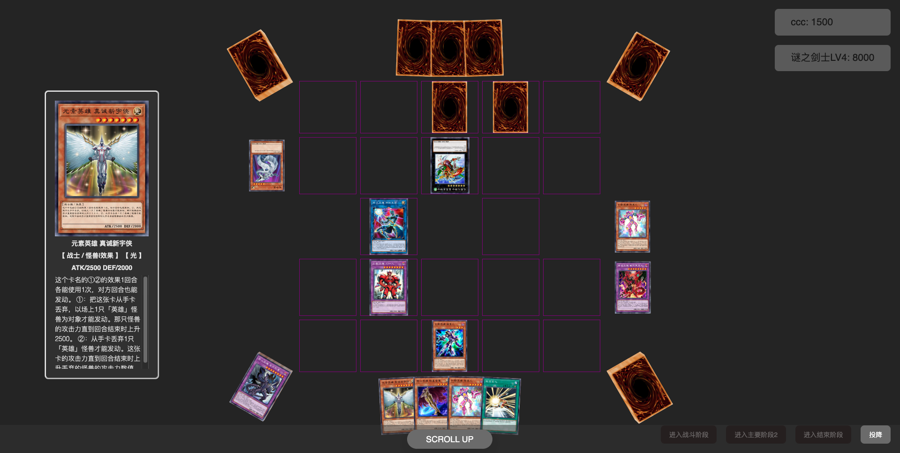

<p align="center">
  <a href="https://neos.moecube.com">
     
    <h1 align="center">NEOS</h1>
  </a>
</p>


<p align="center">
  <a aria-label="Language" href="https://www.typescriptlang.org/">
    
  </a>
  <a aria-label="React" href="https://reactjs.org/">
    
  </a>
  <a aria-label="License" href="https://github.com/DarkNeos/neos-ts/blob/main/LICENSE">
    
  </a>
</p>

[English](./README.md) | 简体中文

Neos是一个基于[TypeScript](https://www.typescriptlang.org/)，[React.js](https://reactjs.org/)和[WebAssembly](https://webassembly.org/)开发的网页版[游戏王](https://www.yugioh-card-cn.com/)对战平台。

## 公测!!
NEOS现在开启公测啦，详情请移步[萌卡社区帖子](https://ygobbs.com/t/447323)。

## ✨ 功能

- **竞技匹配**
  - 与MyCard天梯其他数万名玩家激战，力争最强。每月最后一天22点结算，公布排名并获取奖励。
- **娱乐匹配**
  - 暂且搁置胜负，享受决斗的乐趣。过去一周竞技匹配使用数最多的20个卡组将被禁用。
- **MC观战列表**
  - 观看萌卡服务器上正在进行的决斗。
- **单人模式**
  - 在Koishi 7210服务器上开启一场与AI的决斗，验证自己的卡组，或者只是打发时间。
- **自定义房间**
  - 创建自定义规则的房间，与好友约战。
- **录像回放**
  - 自由查看进行过的决斗，回味那些精彩的逆转瞬间。

## 📦快速开始
请移步[玩家向导](https://doc.neos.moe/docs/category/%E7%8E%A9%E5%AE%B6%E6%8C%87%E5%8D%97)

## 截图
<p align="center">
  
</p>

## 文档
请移步[Neos文档](https://doc.neos.moe)。

## 开发与场地图资源

场地图由 [neos-filed](https://code.moenext.com/hex/neos-filed) 的 CI 从上游转换为 WebP，当前项目通过 Git submodule 固定图片和清单的版本。首次开发或构建前初始化该依赖：

```sh
npm run fields:init
npm ci
npm run dev
```

更新场地图时运行 `npm run fields:update`，验证后将 `neos-filed` 的新提交指针纳入主项目提交。主项目无需安装 WebP 转换器。开发和生产环境继续使用 `/neos-assets/fields/<卡号>.webp`，无法加载时仍回退到远程场地图。

## 部署站点
* 在萌卡社区部署的站点：https://neos.moecube.com
* 在[Cloudflare](https://www.cloudflare.com/)部署的站点：https://www.neos.moe

## 🤝贡献
在[gitlab仓库](https://code.mycard.moe/mycard/Neos)中创建`Merge Request`来进行代码贡献。

## 🔗Community
Neos目前在[萌卡社区](https://mycard.moe/)部署， 欢迎加入[QQ群](https://github.com/DarkNeos/ygopro-doc/blob/main/assets/ygo_qq.png)和我们一起交流。

## 为什么要开发Neos？
- [作者写的一篇文档](./docs/release-2023_02_19_CN.md)
- 在[ygobbs论坛](https://ygobbs.com/)发布的[帖子](https://ygobbs.com/t/ygopro%E7%BD%91%E9%A1%B5%E7%89%88%E5%BC%80%E5%8F%91%E8%BF%9B%E5%B1%95/403397)

## 作者列表
- Chunchi Che ([@SKTT1Ryze](https://github.com/SKTT1Ryze))
- timelic [@timelic](https://github.com/timelic)

## 开源许可证
                    GNU GENERAL PUBLIC LICENSE
                       Version 3, 29 June 2007

 Copyright (C) 2007 Free Software Foundation, Inc. <https://fsf.org/>
 Everyone is permitted to copy and distribute verbatim copies
 of this license document, but changing it is not allowed.
