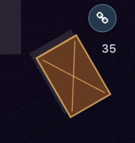
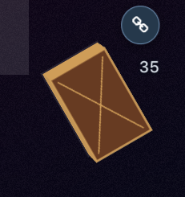

# 卡组、选择请求与回放定位

各模块通过公开操作验证完整流程，界面和输入 adapter 负责呈现及传递请求。

- `CardSelectionProcess` 管理候选身份、本次勾选、合法性和提交。场上点选与弹窗共用流程；逐张选择只提交本次点击，必选卡与本次勾选分开。
- `PersonalCloudDecks` 管理个人云卡组的账号归属、原始记录、内容加载、保存、确认删除和缓存。侧边栏与在线列表共用生产 adapter，测试用内存缓存与模拟接口；删除清理原账号缓存，晚到的读取不能恢复已删除或已保存的旧版本。
- `OnlineDecks` 管理查询范围、查询词和分页。个人记录变化时重新计算当前查询，不重复读取云端；旧查询不覆盖新结果，删除结果通过记录所有者判断。
- `DeckDraft` 管理组卡草稿的身份、异步加载、未保存修改、保存版本和训练返回。生产 adapter 连接卡组库与编辑器，测试 adapter 控制加载和保存的完成时机。保存失败保留原草稿；保存期间的新修改继续标记为未保存。
- `DuelChoice` 管理选项、确认、表示形式和卡名宣言的请求身份、取消、提交合法性及发送结果。界面传入请求编号，旧点击不能提交新请求；发送未完成时保留当前选择。主动动作的本地效果选择与直接发送协议响应使用各自的 adapter。
- `ReplayPlayback` 管理消息推进、暂停、定位重建、渲染确认和输入会话关闭。定位等待当前 handler 完成；旧会话关闭和旧渲染确认不影响新定位。

## 模块测试

在 Node.js 24 下验证，可以直接运行 TypeScript 测试，无需浏览器和远端服务器：

```sh
npm run test:unit
```

## 浏览器回归

通过真实页面验证两种选卡呈现、选择请求、云卡组操作、组卡草稿和训练返回，以及定位完成时的牌面。云卡组测试模拟全部请求，保存和删除检查不会修改真实账号数据。

```sh
npm run test:e2e -- tests/e2e/selection-dialogs.spec.ts tests/e2e/field-interaction.spec.ts tests/e2e/session-and-selection.spec.ts
npm run test:e2e -- tests/e2e/cloud-deck-library.spec.ts tests/e2e/mdpro-online-decks.spec.ts tests/e2e/deck-editor-order.spec.ts tests/e2e/deck-training.spec.ts
npm run test:e2e -- tests/e2e/replay-enhancements.spec.ts tests/e2e/replay.spec.ts tests/e2e/replay-msg-regression.spec.ts tests/e2e/deck-operations.spec.ts
```

回放定位返回 `Promise<boolean>`，恢复牌面并收到本次渲染确认时返回 `true`，取消或无法定位时返回 `false`。低帧率回归直接等待这个结果后读取 DOM，避免依赖内部方法或等待样式最终收敛。

实时录像继续在消息接收时保存原始协议数据，录制不经过演出队列。排序、指示物和已有选卡数学规则保留原有职责。

训练设置保留用例也已更新退出操作：点击返回编辑器会先打开退出训练弹窗，需要选择直接退出后再检查编辑内容。旧用例遗漏这个确认步骤，因此一直等待编辑器出现；新的用例还确认连接关闭，并继续核对未保存卡组和训练选项。

## 场地渲染与动画

`FieldRelationsProvider` 集中计算装备、持续对象与连锁对象的关系，卡片本体只接收自己的高亮状态。关系标记和连锁编号在独立子组件中更新，其他卡片的状态和连锁处理不触发全场卡片本体重渲染。

牌堆顶部三张保留完整内容，其余主卡组、额外卡组、墓地和除外卡使用单张图片表面，保留每层原有的位置、正反面和卡套，恢复连续的牌堆边缘。下层表面不响应点击，也不创建菜单和标记；预留衍生物和静止的超量素材继续隐藏。全部卡片仍保留协议状态、位置、弹簧和动画监听；移动、公开或发动展示时恢复完整内容，结束后按当前位置恢复下层表面或隐藏。

厚度回归使用双方各 35 张主卡组和 15 张额外卡组，分别检查默认及自定义卡套。修复前主卡组只绘制三层，投影厚度约 0.73px；修复后绘制 35 层，厚度约 12.18px，与优化前一致，额外卡组约 4.95px。该用例还验证反转卡组时已知卡显示正面、未知卡保留卡背，以及抽卡、洗牌、切换卡套和卡套加载失败后的默认卡背。被遮住的连锁来源另有完整内容与轻量表面的切换检查。

同一卡套、35 张卡和视角的截图对照，图片使用固定测试响应：

| 修复前，仅顶部三层                            | 修复后，保留全部边缘                         |
| --------------------------------------------- | -------------------------------------------- |
|  |  |

卡片使用固定布局尺寸，通过 transform 缩放到实际大小。深度、翻面和发动光晕直接写入对应元素，不逐帧修改继承的 CSS 变量。数值与关系按钮保持原有尺寸；动画测试检查实际矩阵、可见性和命中位置。攻击四个阶段有明确时长，使用用户动画速度和回放倍速，完成归位后才释放本条消息的等待。

```sh
npm run test:e2e -- tests/e2e/chain-visibility.spec.ts tests/e2e/confirm-cards.spec.ts tests/e2e/grave-order.spec.ts --workers=1
```

渲染回归在测试返回的 Card 模块中插入计数器，不向生产源码加入性能探针。固定录像 `fixtures/replays/1/replay.yrp3d` 从消息 0 播放到 200，记录 Card 调用、长任务和帧回调间隔，并检查渲染次数上限。帧回调间隔用于比较主线程停顿，不作为显示器实际帧率。`PLAYWRIGHT_CARD_PROFILE_BASELINE=1` 仅用于对旧版本采样时跳过次数上限。

2026-10-11 在同一台 macOS 主机上，对改动前的 `96d8465f`、第一版优化和补回牌堆边缘的代码分别顺序采样两次。使用 Vite 开发构建、本机无头 Chrome、1920×1080、动画速度 0.7、回放 1×；数据库和卡图采用相同的测试响应。Playwright 的 Desktop Chrome 配置会设置 Windows UA，它不代表实际宿主系统。

| 指标                     |          改动前 |     第一版优化 |   补回牌堆边缘 |
| ------------------------ | --------------: | -------------: | -------------: |
| Card 渲染调用            | 10,143 / 10,143 |      987 / 987 |      987 / 987 |
| 保留的卡片控制器和根节点 |       152 / 152 |      152 / 152 |      152 / 152 |
| 完整卡片内容             |       152 / 152 |        24 / 24 |        24 / 24 |
| 下层轻量表面             |           0 / 0 |          0 / 0 |      102 / 102 |
| 页面 DOM 元素            |   1,878 / 1,878 |      726 / 726 |      828 / 828 |
| 超过 50ms 的长任务       |         21 / 22 |          9 / 8 |          8 / 9 |
| 长任务总时长             | 2,781 / 2,784ms |    631 / 610ms |    569 / 610ms |
| rAF 间隔 P99             | 133.4 / 133.3ms |      50 / 50ms |      50 / 50ms |
| 播放到相同消息位置       |  14.16 / 14.12s | 12.79 / 12.84s | 12.78 / 12.78s |

补回牌堆边缘后，渲染调用仍比优化前减少约 90.3%，完整内容数量和 rAF 间隔未回退；为恢复原有外观增加 102 个轻量表面。这些数据用于验证本地更新开销的变化，不能直接与 Windows 生产构建的诊断数字比较，也不证明 Windows 实际呈现帧率。该录像片段没有攻击消息；攻击另有直接攻击、指定目标攻击、速度规则和归位回归。
